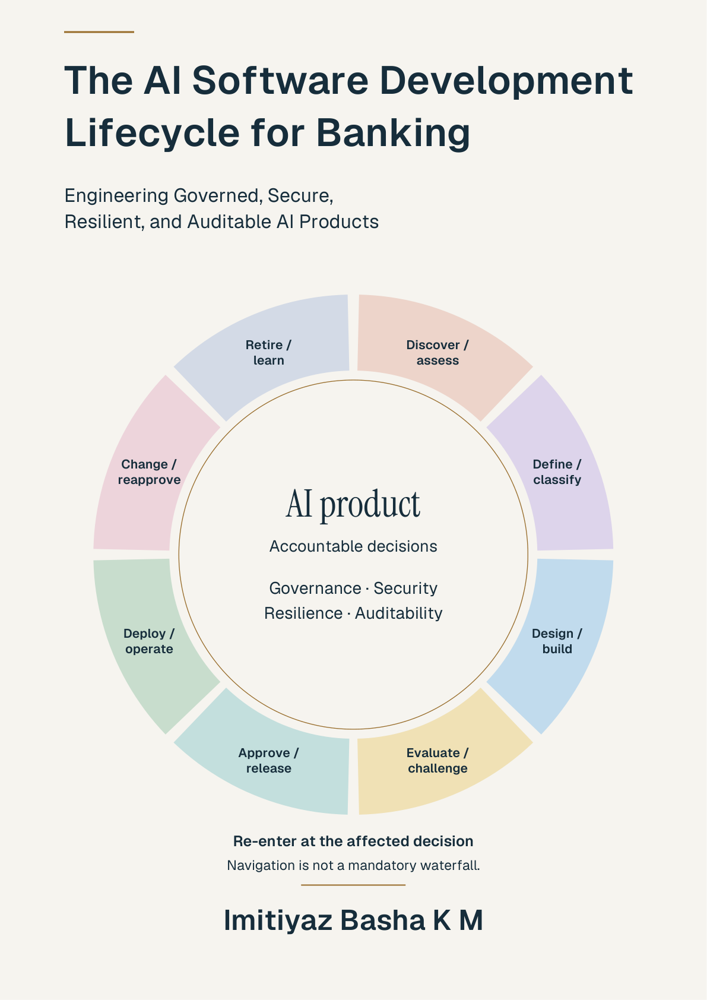

# The AI Software Development Lifecycle for Banking

**Engineering Governed, Secure, Resilient, and Auditable AI Products**

**First Edition · Imitiyaz Basha K M**

  

**[Read the book (PDF)](./The-AI-Software-Development-Lifecycle-for-Banking_Full-Book_First-Edition.pdf)** · **[Open the PDF directly](https://raw.githubusercontent.com/Imitiyaz/ai-sdlc/main/The-AI-Software-Development-Lifecycle-for-Banking_Full-Book_First-Edition.pdf)**

## About the book

AI in banking extends beyond a model. A banking AI product brings together data, software, models, retrieval, tools, people, providers, permissions and operating controls—with consequences for customers and the institution.

This book offers a practical approach to engineering and governing that product throughout its lifecycle. It connects technical implementation with accountable decisions, evidence, security, resilience and auditability, from the first value hypothesis through operation, change and retirement.

## Who this book is for

- Banking technology leaders and product owners establishing direction and accountability.
- Architects, software and AI engineers designing and building banking AI products.
- Security, risk, compliance, model-validation and audit professionals assessing evidence and controls.
- Operations and service teams managing release, monitoring, incidents, recovery and change.

## What you will learn

- Define product boundaries, intended use, prohibited use and decision rights.
- Connect decision, implementation, assurance, operating and change evidence to product and release identities.
- Design AI architecture, data and knowledge flows, model dependencies, tools, agents and human oversight.
- Evaluate claims and limitations, test security and resilience, and prepare evidence for independent challenge.
- Govern release, operation, incident response, reapproval, provider exit and retirement.
- Apply the concepts through workflows, worked examples, evidence tables and fictional banking scenarios.

## The lifecycle

The book uses eight phases:

1. **Discover / assess**
2. **Define / classify**
3. **Design / build**
4. **Evaluate / challenge**
5. **Approve / release**
6. **Deploy / operate**
7. **Change / reapprove**
8. **Retire / learn**

Governance, security, resilience, auditability and accountable decisions span the lifecycle. Re-enter at the affected decision when circumstances change. Lifecycle navigation is not a mandatory waterfall or a grant of permission to proceed.

## Inside the book

Thirty chapters are organized into six parts:

| Part | Title | Focus |
| --- | --- | --- |
| I | Why AI Changes the Lifecycle | Product boundaries, evidence lineage and banking consequences. |
| II | Strategy, Use, Risk and Accountability | Value, investment, intended use, classification and decision rights. |
| III | Architecture and Design | Product architecture, data, knowledge, model supply, workflows, tools and agents. |
| IV | Engineering, Evaluation and Assurance | Software engineering, evaluation, red teaming, security, fairness, oversight and quality gates. |
| V | Release, Operation and Change | Deployment, incidents, performance, resilience, change and retirement. |
| VI | Institutionalization and Domain Use | Operating models, maturity, transformation, domain playbooks and banking traces. |

The book also includes appendices, illustration descriptions, a glossary, a bibliography and a subject index.

## How to use the book

Start with **Preface: Why This Book Exists**, **The Reader Promise** and **How to Use This Book**. The **Executive Brief: Decisions Before Scale**, **The First-Hour Path** and **Audience Pathways** offer routes into the material for different roles.

Use the Contents, Lists of Figures and Tables, glossary and index to navigate to specific topics. **Figure P.3 — AI SDLC: the full lifecycle** provides the detailed orientation map. Illustration descriptions provide textual explanations of the visuals.

## About the author

**Imitiyaz Basha K M** is a technology engineering leader with more than 18 years of experience in banking. He has delivered digital banking, cloud, API and DevSecOps initiatives for Standard Chartered, Citi, Credit Suisse, DBS and Affin Bank.

His background spans software delivery, architecture, security, project and vendor management, and leading cross-functional teams. This book draws on that experience to offer a practical approach to engineering and governing AI products in banking.

He holds a master’s degree in Computer Applications from Anna University, India. His professional certifications include PMP, TOGAF Enterprise Architecture Practitioner, CCSP and AWS Certified AI Business Strategist.

[LinkedIn](https://www.linkedin.com/in/imitiyaz) · [Book repository](https://github.com/Imitiyaz/ai-sdlc)

## Reading context

This book is educational and does not provide professional advice or establish compliance, safety, security, fairness, resilience or control effectiveness. Readers should verify current sources, determine applicability, use qualified professionals and follow their institution’s approvals.

All Fictional Bank cases and numerical results are constructed teaching examples. They do not report an actual bank, customer, deployment, test, financial benefit or regulatory outcome.

## Copyright

© 2026 Imitiyaz Basha K M. All rights reserved.
